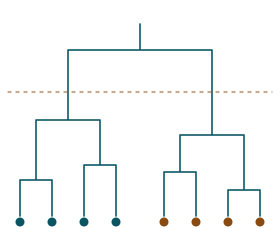
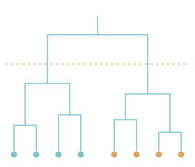



::::: {.home-wrap}

:::: {.hero}
::: {.hero-text}
::: {.overline}
Associate Professor of Statistics · University of Cagliari
:::

# Luca Frigau

::: {.lead}
I develop statistical learning methods (tree-based models, clustering
methods and text mining) and apply them to questions in tourism, health,
transport and the life sciences.
:::

::: {.affiliation}
Department of Economics and Business Sciences, University of Cagliari, Italy.
:::


:::

::: {.hero-art}
```{=html}


```
:::
::::

:::: {.home-section .home-band}
::: {.overline}
Research
:::

## Questions I work on

::: {.section-intro}
Five lines of research, each told as a story with an illustration: the
question it started from and how the work has developed since.
:::



::: {.more-link}
[All research, including applied work and funded projects →](research.qmd)
:::
::::

:::: {.home-section .home-columns}
::: {.home-col}
::: {.overline}
News
:::

## Recently



::: {.more-link}
[All news →](news.qmd)
:::
:::

::: {.home-col}
::: {.overline}
Publications
:::

## Selected work



::: {.more-link}
[All publications, with a timeline and a map of citations →](publications.qmd)
:::
:::
::::

::: {.home-section}
::: {.overline}
Software
:::

## Code, data and apps

::: {.section-intro}
Code and data that accompany my articles. Interactive R Shiny applications
will be listed here as they are released.
:::



::: {.more-link}
[All software and apps →](software.qmd)
:::
:::

:::: {.home-section .home-duo}
::: {.duo-item}
##  Teaching {#teaching}

I teach Statistics at bachelor's level and Market Analysis at master's level at
the University of Cagliari, and contribute to doctoral and second-level
master's programs.

::: {.more-link}
[Courses and supervision →](teaching.qmd)
:::
:::

::: {.duo-item}
##  Contact {#contact}

The best way to reach me is by email at
[frigau@unica.it](mailto:frigau@unica.it). Office hours are published on my
university page.

::: {.more-link}
[Contact details →](contact.qmd)
:::
:::
::::

:::::
